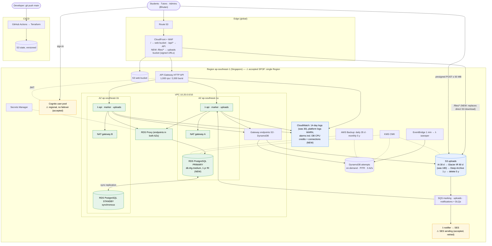

# Revised architecture: cost-optimised, Singapore (ap-southeast-1)

The Assignment 2 design is kept where the cost report and failure analysis support it, and changed where they did not. Every single point of failure (SPOF) is marked below as **removed** (redundant now) or **accepted** (a deliberate trade-off, with the reason and the mitigation).

## 1. Diagram

Legend: **green** = SPOF removed by redundancy · **amber** = SPOF accepted · **blue** = changed in Assignment 3.

The diagram source is also in [`diagram.mmd`](diagram.mmd).

## 2. Single points of failure

| # | Component | Status | How it is handled | Tested by |
| --- | --- | --- | --- | --- |
| 1 | RDS primary instance | **Removed** | Multi-AZ synchronous standby with automatic failover; **measured API outage ≤ 17 s** in three forced failovers; no committed data lost | Failure test 1 |
| 2 | Availability Zone (Lambda, NAT, subnets) | **Removed** | Lambda ENIs, NAT gateway and route table in each AZ | Failure test 1 |
| 3 | Database connections during a burst | **Removed** | RDS Proxy pools connections; Lambda concurrency on queue workers is capped | Load test |
| 4 | Database CPU at peak (burstable t4g instance) | **Accepted, monitored** | New alarms on `CPUCreditBalance` and `DatabaseConnections`. The load test peaked at 6.4% CPU with a stable credit balance, so no change is needed; db.m7g.large for exam months (+USD 387 a year) stays the fallback | Load test: [`../infra/load-test.md`](../infra/load-test.md) |
| 5 | Lambda account concurrency limit | **Accepted, monitored** | Default 1,000 concurrent executions; the load test measured a peak of 13 (0 throttles); `Throttles` alarm | Failure test 2 |
| 6 | Marking worker or a bad message | **Removed** | SQS retries, then a dead-letter queue and an alarm; marking is idempotent, so redrive is safe | Failure test 3 |
| 7 | Accidental deletion or corruption of data | **Removed** | DynamoDB and RDS point-in-time recovery; AWS Backup; S3 versioning | Failure test 4 |
| 8 | Single Region (Singapore) | **Accepted** | A Region-wide outage is rare and the brief only requires AZ resilience. Recovery is a Terraform redeploy to Mumbai plus restoring backups, which exceeds the 1-hour RTO; this is documented as a known gap | Not tested (cost) |
| 9 | Cognito user pool | **Accepted** | Regional managed service with no cross-Region failover. Already signed-in students keep working for up to 60 minutes on their current token | — |
| 10 | SES sending | **Accepted** | E-mails are queued in SQS and retried; a delay does not affect exams | Failure test 3 (same pattern) |
| 11 | Deployment pipeline | **Accepted** | Not on the runtime path; if GitHub is down, Terraform can run from a laptop | — |
| 12 | One NAT gateway (Learner Lab only) | **Accepted in the lab only** | Saves lab credit; production keeps two (cost report §4.3) | — |
| 13 | No CloudFront or WAF (Learner Lab only) | **Accepted in the lab only** | The lab denies `cloudfront:CreateDistribution`; API Gateway serves the app over HTTPS via a small `web` Lambda. Production keeps CloudFront + WAF | — |

## 3. Change log against Assignment 2

| # | Change | Reason | Effect |
| --- | --- | --- | --- |
| 1 | Region changed from ap-south-1 (Mumbai) to **ap-southeast-1 (Singapore)** | Requested by the university | +USD 343 a year compared with Mumbai; +10 ms from Bhutan (cost report §5) |
| 2 | RDS sized **db.t4g.medium Multi-AZ on a 1-year Reserved Instance** (was db.t4g.micro on demand) | micro is too small for 3,000 students; RI saves 25% over on demand | USD 111/month instead of USD 148 on demand |
| 3 | **Submission downloads through CloudFront** (`/files/*` with signed URLs) instead of direct S3 presigned GETs | Data transfer out from S3 was the largest hidden cost | −USD 547 a year |
| 4 | **Glacier Instant Retrieval at 90 days** (was 180) | Files are rarely opened after marking; GIR still serves them in milliseconds | −USD 68 a year |
| 5 | **Leaner logging**: 14-day retention (was 30), Lambda platform logs at WARN, API access logs only during tests | Logs were the fastest-growing operational cost at peak | −USD 96 a year |
| 6 | **New alarms**: RDS `CPUCreditBalance` and `DatabaseConnections`, Lambda `Throttles` | Load test and failure analysis identified these as the first things to fail | Earlier warning |
| 7 | **Load-test switch** `enable_load_test_auth` | Lets the load test sign in test students without the browser | Off in production |
| 8 | **Provisioned concurrency on the API alias during exam windows** (15 × 512 MB; `api_provisioned_concurrency`), with the database connection opened during warm-up | The load test proved the only slow requests are Lambda cold starts (1.1–1.5 s) when the load steps up | +USD 7.86 a year; removes the cold starts at exam start |
| 9 | Kept: 2 NAT gateways, RDS Proxy, WAF, DynamoDB on-demand | Cost report §4: each alternative was cheaper only by giving up resilience, or not cheaper at all | — |

Changes 1, 2, 4, 5, 6, 7 and 8 are already in the Terraform (change 8 is switched on per exam window; the Learner Lab denies it) in [`../infra`](../infra). Change 3 is designed and costed but not yet implemented in code: it needs a CloudFront key group and a signing key, and it changes the download link format in `backend/api.py`. The alarm thresholds in change 6 are checked against the load-test results in [`../infra/load-test.md`](../infra/load-test.md).
